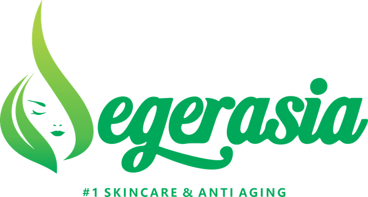

<div align="center">

<!-- ═══════════════════════════════════════════════════════════════ -->
<!--   D  E  G  E  R  A  S  I  A   —   Official Website             -->
<!-- ═══════════════════════════════════════════════════════════════ -->



# ✨ KLINIK DEGERASIA — Official Website

### *Seni Menemukan Keanggunan Alami Wajah Anda.*

**Website resmi Dr. Fatri Idana, M.Biomed., AAM** — Senior Dokter Kecantikan, Owner Klinik Degerasia & Founder Brand Skincare **DEGERA**.

Production-grade, full-stack, multi-page, 45+ halaman, siap deploy. 🌿

[](https://nextjs.org)
[](https://react.dev)
[](https://www.typescriptlang.org)
[](https://tailwindcss.com)
[](https://www.prisma.io)
[](https://sqlite.org)

[](#-peta-halaman)
[](#-peta-halaman)
[](#-peta-halaman)
[](#-perintah)
[](#-lisensi)

[🌿 Tentang](#-tentang-project) · [🗺️ Peta Halaman](#-peta-halaman) · [⚡ Instalasi](#-instalasi-cepat) · [🎨 Design System](#-design-system) · [🔌 API](#-api-documentation) · [📜 Lisensi](#-lisensi)

</div>

---

> 🌺 *"Kecantikan sejati lahir dari perpaduan presisi sains medis estetika dan rasa seni yang tulus — untuk hasil yang memancar dari dalam."*
>
> — **dr. Fatri Idana, M.Biomed., AAM**

---

## 🌿 Tentang Project

Website **Klinik Degerasia** adalah aplikasi web full-stack kelas produksi yang dibangun untuk:

| Peran | Detail |
|:---|:---|
| 👩‍⚕️ **Personal Branding** | Profil profesional dr. Fatri Idana, M.Biomed., AAM — 15+ tahun pengalaman |
| 🏥 **Katalog Klinik** | 13 treatment estetika premium dengan halaman detail lengkap |
| 🧴 **Katalog Produk** | 21 produk skincare **DEGERA** dengan nomor BPOM resmi (2022–2025) |
| 📝 **Reservasi** | Form reservasi full-stack: UI → API → validasi → database |
| 📰 **Content Marketing** | Degerasia Journal — artikel edukasi SEO-friendly |
| 💬 **Konversi** | Multi-path: WhatsApp deep-link personal, form, Google Maps |

**Mengapa project ini spesial?**

- ✅ **Data 100% riil** — nomor BPOM asli, alamat klinik asli, harga eceran resmi
- ✅ **Single Source of Truth** — seluruh konten tersentralisasi di 1 file TypeScript
- ✅ **45+ halaman statis** — SSG (Static Site Generation) via `generateStaticParams`
- ✅ **Zero-error** — ESLint 0 error, runtime log bersih, terverifikasi end-to-end via browser automation
- ✅ **Desain luxury botani emerald** — terinspirasi klinik kelas dunia, mengikuti identitas logo asli

---

## 🗺️ Peta Halaman

**45+ halaman** aktif dalam 9 keluarga route:

| Route | Halaman | Tipe | Deskripsi |
|:---|:---|:---:|:---|
| `/` | Beranda | SSG | Hero editorial, stats animasi, mega menu, 13 layanan, 21 produk, journal, journey, testimoni |
| `/tentang` | Tentang | SSG | Biografi dr. Fatri, kredensial, visi-misi, timeline, foto tim |
| `/layanan` | Layanan | SSG + Filter | 13 treatment, tab filter 3 kategori, trust strip |
| `/layanan/[slug]` | Detail Treatment | **SSG ×13** | Manfaat, timeline proses, FAQ accordion, durasi/downtime/harga, CTA WA personal |
| `/produk` | Produk | SSG + Filter | 21 produk BPOM, tab filter 6 kategori, strip edukasi Kemenkes |
| `/produk/[slug]` | Detail Produk | **SSG ×21** | Harga, badge BPOM + nomor, kemasan/bahan/cara pakai, CTA WA personal |
| `/galeri` | Galeri | SSG | Grid masonry dengan overlay hover |
| `/artikel` | Journal | SSG | 6 artikel, badge kategori, meta tanggal & waktu baca |
| `/artikel/[slug]` | Artikel | **SSG ×6** | Layout editorial, author box, artikel terkait |
| `/promo` | Promo | SSG | 4 kartu program, klaim via WhatsApp |
| `/faq` | FAQ | SSG | Accordion 10 pertanyaan + CTA chat |
| `/kontak` | Kontak & Reservasi | SSR | Form full-stack, info klinik, Google Maps |
| `/*` | 404 Custom | — | Slug tidak valid otomatis `notFound()` |

**Layanan signature dr. Fatri:** F-Silk Glow ✦ F-Peeling Pro ✦ F-Plasma Rejuv ✦ F-Lift Ultra

---

## ⚡ Instalasi Cepat

### Prasyarat

| Tools | Versi | Cek |
|:---|:---:|:---|
| [Bun](https://bun.sh) | ≥ 1.1 | `bun --version` |
| Node.js *(opsional, via Bun)* | ≥ 20 | `node --version` |

> 💡 Bun dipilih karena jauh lebih cepat dari npm/yarn dan native TypeScript. Semua perintah juga kompatibel dengan `npm`/`pnpm` bila diganti manual.

### Setup dalam 60 detik 🚀

```bash
# 1️⃣ Clone repository
git clone https://github.com/prabudanling/degeracorp.git degerasia
cd degerasia

# 2️⃣ Install dependensi (super cepat dengan Bun)
bun install

# 3️⃣ Konfigurasi environment
echo 'DATABASE_URL=file:/absolute/path/ke/db/custom.db' > .env

# 4️⃣ Push schema ke database + generate Prisma Client
bun run db:push

# 5️⃣ Jalankan development server
bun run dev
```

Buka **[http://localhost:3000](http://localhost:3000)** — selesai! 🎉

### Produksi

```bash
bun run build        # Build optimasi + standalone output
bun run start        # Jalankan production server
```

---

## ⌨️ Perintah

| Perintah | Fungsi |
|:---|:---|
| `bun run dev` | 🔥 Development server di port 3000 (Turbopack, hot-reload) |
| `bun run build` | 📦 Build produksi + copy static ke standalone |
| `bun run start` | 🚀 Jalankan server produksi (standalone) |
| `bun run lint` | 🔍 ESLint — saat ini **0 error** ✅ |
| `bun run db:push` | 🗄️ Push schema Prisma → SQLite |
| `bun run db:generate` | ⚙️ Generate Prisma Client |
| `bun run db:migrate` | 📜 Migration development |
| `bun run db:reset` | ♻️ Reset database |

---

## 🏗️ Arsitektur

```
┌─────────────────────────────────────────────────────────────────────┐
│                         🌐 BROWSER (Client)                         │
│   Navbar mega-menu · Framer Motion · Form · Toast · Accordion       │
└──────────────────────────────────┬──────────────────────────────────┘
                                   │ fetch()
┌──────────────────────────────────▼──────────────────────────────────┐
│                    ▲ NEXT.JS 16 — APP ROUTER                        │
│                                                                     │
│  ┌──────────── Server Components (SSG) ──────────────────────────┐  │
│  │  45+ halaman · generateStaticParams · generateMetadata        │  │
│  │  SEO otomatis · notFound() guard · next/image                 │  │
│  └───────────────────────────┬───────────────────────────────────┘  │
│                              │                                      │
│  ┌──────────── Client Components ────────────────────────────────┐  │
│  │  navbar · product-grid · service-grid · reservation-form      │  │
│  │  floating-actions · reveal · stats counter · testimonials     │  │
│  └───────────────────────────┬───────────────────────────────────┘  │
└──────────────────────────────┼──────────────────────────────────────┘
                               │
        ┌──────────────────────▼──────────────────────┐
        │        🔌 API ROUTE  POST /api/contact       │
        │   Validasi manual (nama ≥2, WA ≥6, max len)  │
        │        400 ❌  ·  201 ✅  ·  500 ⚠️           │
        └──────────────────────┬──────────────────────┘
                               │
        ┌──────────────────────▼──────────────────────┐
        │           🗄️  PRISMA 6 → SQLITE              │
        │        Model: ContactMessage (cuid)          │
        │      db/custom.db · single source data       │
        └─────────────────────────────────────────────┘
```

### Alur Data Konten (Single Source of Truth)

```
src/lib/degerasia-data.ts  ◄─── 📌 SATU-SATUNYA sumber konten
        │                          (SITE · SERVICES · PRODUCTS · ARTICLES
        │                           PROMOS · FAQS · GALLERY · STATS · JOURNEY)
        ├──► src/app/*/page.tsx          (Server, SSG)
        ├──► src/components/landing/*    (Beranda)
        └──► waLink() / formatPrice() / formatDate()   (Utils terpadu)
```

> 🔑 **Manfaat:** ubah harga produk / nomor WA / tambah treatment cukup di **1 file** → seluruh 45+ halaman ikut terupdate.

---

## 📂 Struktur Project

```
degerasia/
├── 📁 src/
│   ├── 📁 app/                        # App Router (Next.js 16)
│   │   ├── page.tsx                   # 🏠 Beranda
│   │   ├── layout.tsx                 # Root layout + 3 Google Fonts + metadata SEO
│   │   ├── globals.css                # 🎨 Design tokens hijau botani + utilities
│   │   ├── api/contact/route.ts       # 🔌 POST endpoint reservasi
│   │   ├── tentang/ · galeri/ · promo/ · faq/ · kontak/
│   │   ├── layanan/                   # + [slug]/ → 13 halaman detail
│   │   ├── produk/                    # + [slug]/ → 21 halaman detail
│   │   └── artikel/                   # + [slug]/ → 6 artikel
│   ├── 📁 components/
│   │   ├── 📁 landing/                # 18 komponen beranda & shared
│   │   │   ├── navbar.tsx             #    Mega menu + mobile accordion
│   │   │   ├── hero.tsx               #    Split layout + arch-frame + badge melayang
│   │   │   ├── page-header.tsx        #    Band hijau + breadcrumb (subpage)
│   │   │   ├── cta-band.tsx           #    CTA konsultasi reusable
│   │   │   ├── reveal.tsx             #    Animasi on-scroll (Framer Motion)
│   │   │   └── footer.tsx             #    Sitemap 4 kolom + sosmed riil
│   │   └── 📁 ui/                     # 50+ komponen shadcn/ui
│   └── 📁 lib/
│       ├── degerasia-data.ts          # 📌 SINGLE SOURCE OF TRUTH
│       └── db.ts                      # Prisma Client singleton
├── 📁 prisma/schema.prisma            # Model ContactMessage
├── 📁 db/custom.db                    # Database SQLite
├── 📁 public/images/                  # 31 aset visual (produk AI + foto tim asli)
├── 📁 upload/                         # Dokumen asli (BPOM, merek, logo, foto)
├── 📁 scripts/gen-images*.ts          # Generator aset via AI SDK
└── 📄 worklog.md                      # 📔 Riwayat pengembangan lengkap
```

---

## 🎨 Design System

### Palet "Botani Emerald" 🌿

Diekstraksi langsung dari **logo asli DEGERASIA** (#2f9e44 → #1e7a34):

| Token | Hex | Fungsi |
|:---|:---|:---|
| `porcelain` | `#f6f8f4` | Latar utama — putih porselen |
| `sage` | `#e3ede0` | Latar section lembut |
| `mint` | `#d7ecd9` | Aksen highlight |
| `fern` | `#9cc3a2` | Border & hairline |
| `leaf` | `#2f9e44` | **Brand utama** — dari logo |
| `leaf-deep` | `#1e7a34` | Teks aksen & harga |
| `forest` | `#0f3d22` | Section gelap & footer |
| `moss` | `#52715c` | Teks body sekunder |

### Tipografi Editorial ✒️

| Font | Peran | Weight |
|:---|:---|:---|
| **Italiana** | Logo & wordmark | 400 |
| **Cormorant Garamond** | Display/heading serif editorial (normal + italic) | 300–700 |
| **Jost** | Body text geometris modern | 300–600 |

### Signature Elements ✨

- **`.arch-frame`** — potret berbentuk lengkung ala galeri seni
- **`.text-leaf-gradient`** — teks gradient hijau daun
- **`.brand-hairline`** — garis halus brand
- **`.lux-scrollbar`** — scrollbar kustom elegan
- **Reveal on-scroll** — animasi Framer Motion halus di seluruh halaman
- **rounded-3xl + tracking-[0.3em]** — bahasa visual konsisten di 45+ halaman

---

## 🔌 API Documentation

### `POST /api/contact` — Kirim Reservasi

Endpoint full-stack untuk menerima reservasi pasien.

**Request:**

```jsonc
POST /api/contact
Content-Type: application/json

{
  "name": "Nama Lengkap",        // wajib · min 2 karakter · max 120
  "phone": "082236000715",       // wajib · min 6 digit · max 40
  "service": "F-Silk Glow",      // opsional · max 120
  "message": "Pesan singkat"     // opsional · max 2000
}
```

**Respons:**

| Status | Body | Arti |
|:---:|:---|:---|
| `201` | `{ "ok": true, "id": "cmv03q4lc..." }` | ✅ Tersimpan di database |
| `400` | `{ "ok": false, "error": "Nama wajib diisi." }` | ❌ Validasi gagal |
| `400` | `{ "ok": false, "error": "Nomor WhatsApp tidak valid." }` | ❌ Validasi gagal |
| `500` | `{ "ok": false, "error": "Terjadi kesalahan pada server." }` | ⚠️ Error server |

**Contoh (cURL):**

```bash
curl -X POST http://localhost:3000/api/contact \
  -H "Content-Type: application/json" \
  -d '{"name":"Budi","phone":"081234567890","service":"F-Silk Glow"}'
# → {"ok":true,"id":"cmv03q4lc0000jmzxjd0slysr"}
```

### Schema Database (Prisma)

```prisma
model ContactMessage {
  id        String   @id @default(cuid())
  name      String
  phone     String
  service   String?
  message   String
  createdAt DateTime @default(now())
}
```

---

## 🧪 Kualitas & Verifikasi

Project ini **terverifikasi end-to-end** dengan browser automation (bukan sekadar "berjalan"):

| Verifikasi | Hasil |
|:---|:---:|
| 10 route utama → HTTP 200 | ✅ |
| 13 + 21 halaman detail SSG → 200 | ✅ |
| Slug tidak valid → 404 custom | ✅ |
| Client-side navigation & mega menu | ✅ |
| Form submit → toast konfirmasi | ✅ |
| Data tersimpan di SQLite (query Prisma) | ✅ |
| Responsif 1440px (desktop) & 390px (mobile) | ✅ |
| ESLint | ✅ 0 error |
| Runtime log | ✅ Nol error |

---

## 🚀 Deployment

Karena menggunakan `output: "standalone"`, project siap di-deploy ke berbagai platform:

<details>
<summary><b>Docker</b> (click untuk expand)</summary>

```dockerfile
FROM oven/bun:1 AS base
WORKDIR /app
COPY . .
RUN bun install && bun run build

EXPOSE 3000
CMD ["bun", ".next/standalone/server.js"]
```
</details>

<details>
<summary><b>VPS / Vercel / Netlify</b></summary>

```bash
# VPS (Node)
bun run build
NODE_ENV=production bun .next/standalone/server.js

# Vercel → cukup import repo, framework auto-detected
```
</details>

<details>
<summary><b>Checklist Go-Live</b></summary>

- [ ] Ganti `DATABASE_URL` ke path produksi absolut
- [ ] `bun run db:push` di server produksi
- [ ] Update `SITE` di `src/lib/degerasia-data.ts` bila kontak berubah
- [ ] Verifikasi tombol WhatsApp mengarah ke nomor klinik
- [ ] Set domain + SSL
</details>

---

## 🛠️ Tech Stack Detail

| Layer | Teknologi | Keterangan |
|:---|:---|:---|
| Framework | **Next.js 16** (App Router, Turbopack) | SSG + API Routes |
| UI Library | **React 19** | Server + Client Components |
| Bahasa | **TypeScript 5** (strict) | End-to-end typed |
| Styling | **Tailwind CSS 4** + `tw-animate-css` | Design tokens CSS variables |
| Komponen | **shadcn/ui** (New York) — 50+ komponen | Accordion, Tabs, Toast, dll |
| Animasi | **Framer Motion 12** | Reveal, counter, carousel |
| Database | **Prisma 6 + SQLite** | Zero-config, file-based |
| Ikon | **Lucide React** | 1000+ ikon tree-shakeable |
| Font | **next/font** (Italiana, Cormorant Garamond, Jost) | Zero layout shift |
| State | Zustand · TanStack Query *(tersedia)* | Sesuai kebutuhan |
| Runtime | **Bun** | Install & dev super cepat |

---

## 📸 Highlight Fitur

<details open>
<summary><b>🏠 Beranda</b></summary>

- Hero split-layout dengan potret **arch-frame** + ring dekoratif berputar + badge melayang "15+ Tahun Pengalaman"
- Marquee editorial berjalan
- Counter statistik animasi (10.000+ pasien, dll)
- Preview 13 treatment & 21 produk dengan tautan detail
- Journal preview (3 artikel terbaru) + strip promo
- Testimoni carousel auto-rotate dengan kontrol manual
- CTA banner dengan efek ken-burns silk texture

</details>

<details>
<summary><b>🧴 Katalog Produk BPOM</b></summary>

- 21 produk riil 2022–2025 dengan **nomor registrasi BPOM asli** (contoh: NA18222000387)
- Filter 6 kategori: Cleanser · Toner · Serum · Cream · Sunscreen · Istimewa
- Detail: harga eceran resmi, isi kemasan, bahan utama, cara pakai, tahun terdaftar
- Strip edukasi: *"Setiap nomor BPOM dapat diverifikasi via aplikasi resmi cek BPOM Kemenkes"*
- Tombol WhatsApp dengan **pesan ter-personalisasi per produk**

</details>

<details>
<summary><b>💆 Detail Treatment</b></summary>

- Manfaat & keunggulan (checklist)
- Timeline proses bernomor 01–04
- Meta cards: durasi · downtime · harga mulai
- FAQ accordion per-treatment
- Treatment terkait (rekomendasi kategori sama)

</details>

<details>
<summary><b>💬 Multi-Path Konversi</b></summary>

1. **WhatsApp deep-link** — pesan otomatis: *"Halo Klinik Degerasia, saya ingin reservasi [treatment]"*
2. **Form reservasi** — tersimpan permanen di database
3. **Google Maps** — langsung ke lokasi klinik
4. **Facebook** — klinik.gerasia

</details>

---

## 🗺️ Roadmap

- [x] Landing page luxury bertema botani emerald
- [x] Multi-page 45+ halaman dengan SSG
- [x] 21 produk BPOM riil + 13 treatment
- [x] Form reservasi full-stack
- [x] Verifikasi browser end-to-end
- [ ] Panel admin untuk membaca pesan reservasi
- [ ] Notifikasi WhatsApp otomatis saat reservasi masuk
- [ ] Integrasi Google Reviews
- [ ] Blog CMS
- [ ] Multi-bahasa (ID / EN)

---

## 🤝 Kontribusi

Kontribusi sangat diterima! Ikuti alur standar:

```bash
# 1. Fork & buat branch fitur
git checkout -b fitur/fitur-keren

# 2. Commit dengan pesan konvensional
git commit -m "feat: tambahkan fitur keren"

# 3. Pastikan lint bersih sebelum push
bun run lint

# 4. Push & buat Pull Request
git push origin fitur/fitur-keren
```

> 📌 **Aturan konten:** seluruh data klinik wajib melalui `src/lib/degerasia-data.ts` — dilarang hardcode data di komponen.

---

## 📔 Riwayat Pengembangan

Perjalanan lengkap pembangunan website ini didokumentasikan transparan di [`worklog.md`](worklog.md):

| Fase | Milestone |
|:---:|:---|
| 1 | Landing page satu-halaman tema champagne-espresso + 9 aset AI |
| 2 | Retheme **hijau botani** dari logo asli + data klinik riil Sumbawa |
| 3–5 | Riset situs referensi, arsitektur data terpusat, 19 gambar AI baru, komponen shared |
| 6-a | Halaman layanan + produk (SSG lengkap) |
| 6-b | 7 halaman tambahan: tentang, galeri, artikel, promo, faq, kontak |
| 7–8 | Integrasi beranda multi-page + verifikasi browser end-to-end |
| ⚡ | Instalasi ke environment produksi sandbox + verifikasi penuh |

---

## 📄 Lisensi

Proyek ini dilisensikan under **MIT License** — lihat file [LICENSE](LICENSE) untuk detail.

> ℹ️ Identitas brand (DEGERASIA, DEGERA, logo, foto klinik, produk, dan seluruh materi merek) tetap milik **Klinik Degerasia ©** dan dilindungi hak cipta.

---

<div align="center">

## 📍 Hubungi Kami

**KLINIK DEGERASIA** — *Kecantikan & Anti-Aging*

📍 Jl. Sultan Kaharuddin, Dusun Sering, Desa Kerato, Kec. Unter Iwes, Kab. Sumbawa, NTB 84316 *(di depan Masjid Sering / Perempatan Sering)*

💬 WhatsApp: [+62 822-3600-0715](https://wa.me/6282236000715) · Facebook: [klinik.gerasia](https://web.facebook.com/klinik.gerasia)

🕗 Senin–Jumat 09.00–17.00 WITA · Sabtu 09.00–15.00 WITA · Minggu & Libur: Dengan Perjanjian

---

Dibuat dengan 💚 untuk kecantikan alami Indonesia.

**⭐ Jika project ini bermanfaat, berikan star di [repository](https://github.com/prabudanling/degeracorp)!**

</div>
